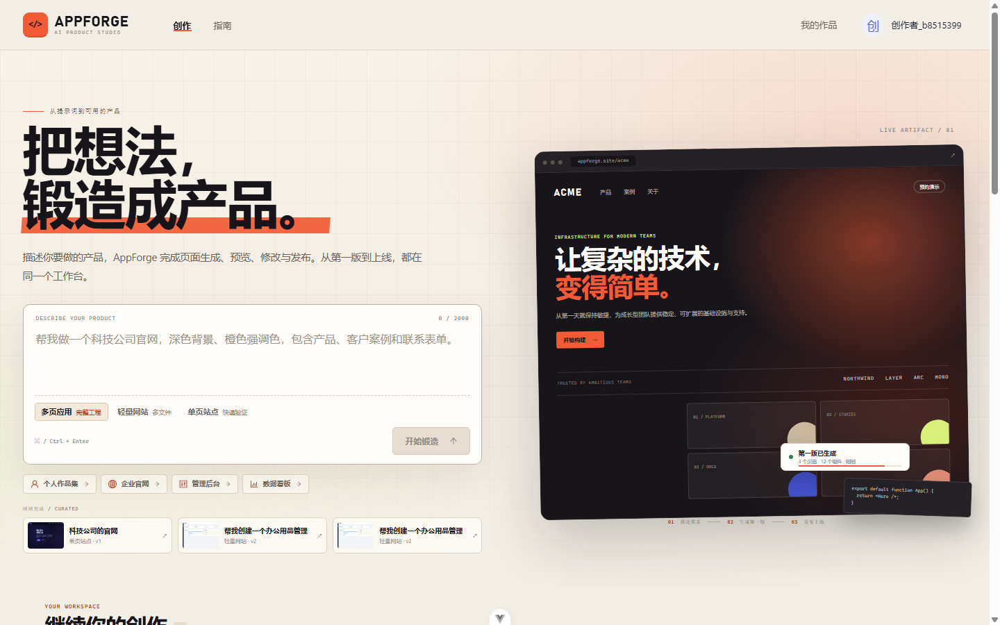
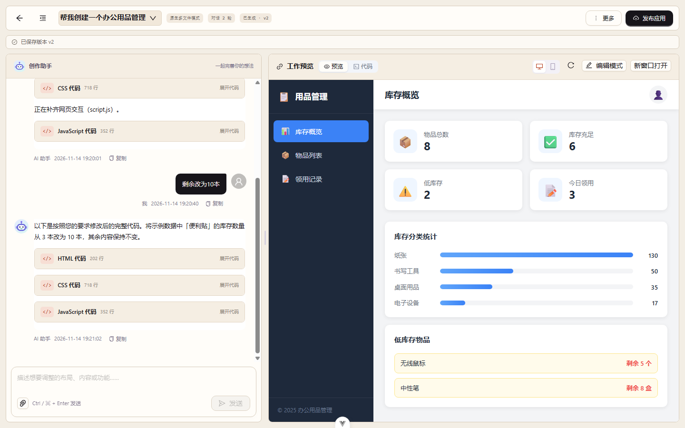
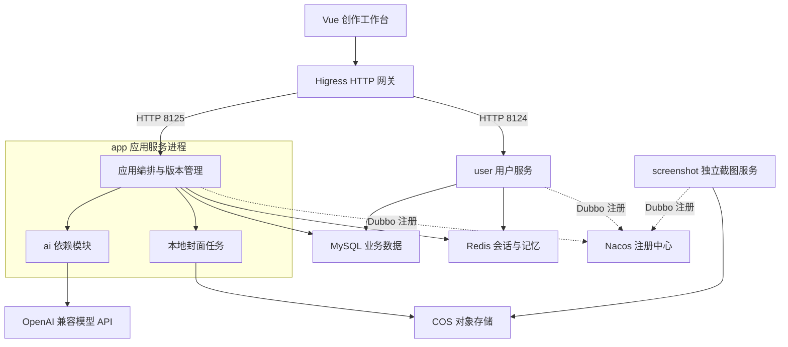
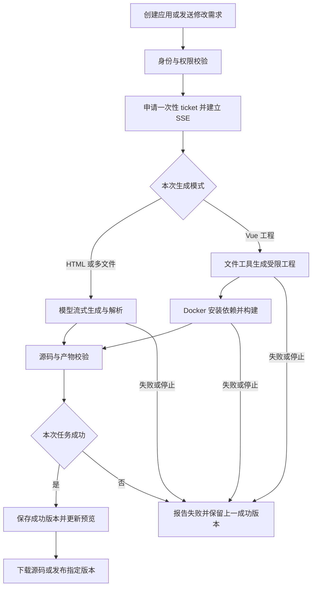

# AppForge

**把想法，锻造成可预览、可修改、可发布的网页应用。**

AppForge 是一个基于 Java 与 Vue 的 AI 应用生成平台。用户描述需求后，在同一个工作台完成代码生成、页面预览、多轮修改、版本对比、源码下载和发布。

> 当前说明对应 `feat/frontend-creation-workspace` 分支，包含 Forge 界面和微服务迁移代码。该分支尚未合并到 `main`。仓库同时保留单体与微服务工程；微服务仍处于拆分和联调阶段，启动方式见下文。

[项目简介](#项目简介) · [功能模块](#项目功能模块) · [项目架构](#项目架构) · [技术选型](#技术选型) · [快速启动](#快速启动) · [微服务指南](appforge-microservices/README.md) · [文档导航](#文档导航)

## 项目简介

AppForge 面向希望通过自然语言创建网页的用户，提供从需求描述到作品交付的一体化创作工作台。平台既支持单页和原生多文件网站，也支持受限 Vue 工程，并在生成后继续提供预览、修改、版本管理与发布能力。

| 场景 | 典型用途 |
| --- | --- |
| 个人展示 | 作品集、简历页、摄影展示与个人主页 |
| 品牌与活动 | 企业官网、产品介绍、活动落地页 |
| 前端原型 | 管理界面、数据看板及交互页面原型 |

管理界面和看板的生成产物属于前端网页，真实业务数据、支付或其他后端能力需要另行接入。项目当前重点是让生成结果能够持续修改、恢复和交付。

## 界面预览

### 创作首页

暖纸色背景、橙色行动按钮与作品展示区组成统一的 Forge 视觉系统。首页提供需求输入、场景示例、生成模式选择、我的作品和公开案例。



### 创作工作台

对话、预览与代码在同一工作区中切换，支持文件差异查看、设备预览、生成进度与版本操作。移动端提供独立的对话和预览切换。



截图使用仓库中的界面验收示例，不代表线上运营数据。更多界面与设计说明见 [Forge UI 改版](docs/ui-redesign/README.md)。

## 功能说明

### 项目功能模块

| 业务模块 | 主要功能 | 关键实现 |
| --- | --- | --- |
| 账号与权限 | 注册、登录、昵称修改、密码修改、管理员协助找回密码 | Redis Session、角色与作品归属校验、一次性重置码 |
| 需求与模式选择 | 场景示例填入需求，选择生成模式，创建后核对保存的模式 | HTML / 多文件 / Vue 工程三种策略 |
| AI 代码生成 | 生成页面、多轮修改、工具操作与文件进度展示 | LangChain4j AI Service、文件工具、SSE 流式事件 |
| 对话与记忆 | 历史分页、Markdown 与代码展示、消息复制、导出和摘要 | MySQL 对话记录、Redis 记忆、按应用隔离上下文 |
| 创作工作台 | 页面预览、源码查看、设备预览、分栏调整、可视化选区修改 | Vue 状态管理、预览 iframe、文件与差异视图 |
| 工程构建 | 安装 Vue 工程依赖、构建 dist、校验构建产物 | 固定 Docker 命令、超时与资源限制、任务取消 |
| 版本管理 | 保存成功版本、文件对比、历史恢复 | 成功后提交版本，失败或停止保留上一成功版本 |
| 源码与发布 | 源码 ZIP 下载、发布、更新发布、下线 | 源码与构建产物管理，预览版本和发布版本独立 |
| 作品发现 | 私有/公开可见性、名称与标签搜索、精选申请 | 公开条件过滤、管理员审核与优先级控制 |
| 附件与素材 | 图片、文本、文档上传与文本提取 | Apache Tika、COS 上传、本地存储回退 |
| 自动封面 | 按版本排队截图、有限重试、查询状态、手动重试、自定义封面 | 数据库任务队列、Chrome/Selenium、COS；需配置外部环境 |
| 安全与请求治理 | 输入检查、文件路径校验、限流与异常反馈 | 输入护栏、受限工作目录、Redisson 与 AOP |
| 缓存与成本优化 | AI Service 实例复用、路由与符合条件的首次生成结果缓存 | Caffeine、Redis；覆盖范围见成本优化文档 |
| 运行观测 | 记录模型请求、错误、Token 用量和响应时间 | Micrometer 指标；单体包含 Prometheus 导出依赖，可配置 Grafana 展示 |

功能表描述仓库已有实现。自动封面、真实模型、云上传与监控采集需要相应环境配置；微服务端到端验收状态见 [当前边界](#当前边界)。

### 用户与管理入口

| 角色 | 主要操作 |
| --- | --- |
| 访客 | 浏览允许公开访问的作品，进入注册和登录页面 |
| 普通用户 | 创建和管理自己的应用，继续生成、恢复版本、下载与发布，申请精选 |
| 管理员 | 用户与应用管理、精选审核和优先级调整、核验身份后签发密码重置码 |

### 三种生成模式

| 首页名称 | 后端类型 | 产物 | 额外运行条件 |
| --- | --- | --- | --- |
| 单页站点 | `html` | 单个 HTML 页面 | 可用的模型 API |
| 轻量网站 | `multi_file` | HTML、CSS、JavaScript 多文件 | 可用的模型 API |
| 多页应用 | `vue_project` | 受限的 Vue 工程与构建后的 `dist` | 模型 API、Docker CLI 与运行中的 Docker daemon |

Vue 工程通过受限文件工具读写源码，再由平台固定的 Docker 流水线安装依赖和构建。只有完整源码通过校验且构建成功，才保存新版本并更新预览。模型不能直接执行任意宿主机命令；当前工程模板不支持任意新增依赖。详见 [Vue 工程生成](docs/06-vue-project-generation.md)。

### 公开作品与精选

新作品默认私有。“全部公开应用”展示符合公开条件的作品；“精选案例”由管理员审核和优先级控制，**不是实时热度排行榜**。没有公开作品或审核通过的案例时显示空状态，不填充虚构作品。

### API Key 与用户费用

当前模型凭据由后端统一配置，用户注册后不需要单独填写 Key。实际模型费用计入后端所用 Key 的账户。个人额度、充值支付、用户自带 Key 和跨实例统一总并发配额不在当前交付范围；现有缓存与任务保护不等同于完整计费系统。

## 项目架构

### 系统结构

平台采用前后端分离结构。单体模式由 `appforge-backend` 承载业务；下图展示微服务接入方式和当前代码中的依赖关系，HTTP 网关路由需要在运行环境中配置。



图中实线表示 HTTP 请求或能力依赖，虚线表示 Dubbo 注册关系。`ai` 是 `app` 的进程内依赖；`screenshot` 已有独立服务入口，但当前 `app` 的封面队列仍调用本地渲染器。独立截图服务与这条任务链的整合仍待完成。

微服务目前仍共享 MySQL 与 Redis Session。HTTP 请求转发到 8124/8125，Triple 端口用于内部接口，不能直接作为 REST 上游。单体运行时，前端直接经开发代理访问 8123，不需要启动 Higress、Nacos 和这些拆分服务。

### 生成与交付流程



SSE 在任务执行期间推送模型文本、工具事件、文件进度与错误。只有生成和必要的构建、校验通过后才保存新版本；首次生成失败时没有成功版本可供预览。发布操作绑定一个成功版本，后续预览修改不会自动覆盖已发布版本。

### 关键设计

| 关注点 | 当前处理方式 | 作用与边界 |
| --- | --- | --- |
| 多模式扩展 | 门面统一生成入口，策略选择解析器，模板方法复用文件保存流程 | 避免不同生成模式的处理逻辑集中在单个分支中 |
| 会话隔离 | 按 appId 管理 AI Service 与记忆，数据库恢复历史窗口 | 作品权限校验仍由业务层负责，memoryId 本身不是权限控制 |
| 流式反馈 | SSE 统一承载文本、工具执行、进度与错误事件 | 停止任务还需取消模型请求和构建进程 |
| 结果保护 | 成功后保存版本；失败和停止保留已有成功结果 | 预览与发布状态分别管理 |
| 构建约束 | 固定命令、受限目录、容器资源限制与超时清理 | 仅支持当前工程模板，不开放任意宿主机命令 |
| 封面任务 | 数据库任务队列、执行租约、有限重试与状态查询 | 应用内任务实现仍需与独立截图服务继续整合 |
| 访问控制 | 登录角色、作品归属、公开状态和发布状态校验 | 静态资源通过业务接口访问，避免直接暴露运行目录 |

### 当前服务划分

| 模块 | 当前实现 |
| --- | --- |
| `user` | 用户服务，HTTP 8124、Triple 50051；注册、登录、昵称和密码修改 |
| `app` | 应用服务，HTTP 8125、Triple 50053；生成、对话、附件、版本、发布和封面任务 |
| `screenshot` | 截图服务，HTTP 8127、Triple 50052；提供截图上传的内部接口 |
| `ai` | 模型、工具、护栏和监控依赖，由 app 进程加载，当前不是独立 AI 服务 |
| `common` / `model` / `client` | 公共能力、数据模型和内部服务契约 |

微服务工程已提供独立启动类与 Dubbo 服务实现；目前 app 仍保留部分本地用户读取逻辑，尚未完成独立分库和全部远程调用。生成任务也包含进程内状态，增加 app 实例前需要补充任务路由、跨节点停止与运行文件访问机制。

## 技术选型

下表按仓库实际依赖说明用途与选择理由。精确版本以各模块 `pom.xml` 和前端 `package.json` 为准。

| 类别 | 技术 | 项目中的用途与选择理由 |
| --- | --- | --- |
| 后端基础 | Java 21、Spring Boot 3.5.16 | 承载业务接口、配置与依赖注入，复用 Spring 生态的 Web、缓存和数据访问能力 |
| 前端 | Vue 3、TypeScript、Vite、Vue Router、Pinia、Ant Design Vue | 组织创作工作台、页面路由和任务状态，提供类型检查与组件化交互 |
| 实时交互 | Spring MVC、SSE、Reactor | 以 HTTP 事件流持续返回生成结果，用响应式流处理模型输出与任务信号 |
| AI 接入 | LangChain4j 1.11.11 核心及相应 starter、OpenAI 兼容接口 | 统一声明式模型调用、工具、记忆与护栏，按配置接入可用模型 |
| 关系数据 | MySQL、MyBatis-Flex、HikariCP | 保存用户、应用、版本、对话和任务数据，提供映射与连接池管理 |
| 会话与记忆 | Redis、Spring Session、LangChain4j Redis Memory | 保存登录态与应用上下文，为拆分服务共享登录态提供基础 |
| 本地缓存 | Caffeine | 缓存应用级 AI Service 实例，减少重复创建；缓存淘汰后按需恢复记忆 |
| 接口治理 | Redisson、Spring AOP、自定义注解 | 按用户、IP 或接口维度限流，复用角色权限校验和异常处理 |
| 工程执行 | Docker、固定 Node 构建镜像 | 为生成的 Vue 工程提供独立构建环境，限制 CPU、内存、进程数与构建时长 |
| 文档与文件 | Apache Tika、腾讯云 COS、本地文件系统 | 提取文档文本，保存附件和封面，管理源码、版本文件与构建产物 |
| 网页截图 | Selenium、Chrome、WebDriverManager | 渲染指定版本页面并生成封面，结合队列和重试处理耗时任务 |
| 服务接口与注册 | Dubbo 3.3.0、Nacos | 提供内部接口与服务注册；迁移中的部分业务仍使用本地调用 |
| HTTP 网关 | Higress | 在微服务部署中统一转发用户与应用 HTTP 请求，集中配置路由和插件 |
| 依赖版本管理 | Spring Cloud 2025.0.0、Spring Cloud Alibaba 2025.0.0.0 BOM | 管理微服务依赖版本；BOM 不代表已实现完整的 Cloud 服务治理 |
| 接口文档 | Springdoc、Knife4j | 提供接口说明与本地联调入口 |
| 指标与监控 | Spring Boot Actuator、Micrometer；Prometheus、Grafana | 记录请求、错误、Token 和耗时；单体已有 Prometheus 导出依赖，采集与看板需在环境中配置 |
| 测试与交付 | JUnit、Spring Boot Test、Vitest、GitHub Actions、Maven/npm | 验证后端逻辑与前端交互，执行构建及选定专项回归；微服务全链路仍需另行验收 |

这些组件分别承担模型接入、持久化、任务执行和交付职责。缓存与限流目前提供局部成本控制，用户计费、全局预算与跨实例总并发配额仍待建设。

## 项目结构

| 路径 | 内容 |
| --- | --- |
| `appforge-backend/` | 单体 Spring Boot 工程、Maven Wrapper 与现有后端回归测试 |
| `appforge-microservices/` | 微服务聚合父工程；common、model、client、ai、user、app、screenshot 七个子模块 |
| `appforge-vue/` | 实际 Vue 前端、API 客户端、页面、组件与 Vitest 测试 |
| `sql/create_table.sql` | 全新数据库初始化脚本 |
| `sql/migrations/` | 已有数据库的分阶段升级脚本 |
| `docs/` | 功能说明、设计、运行边界与验收方法 |
| `docs/ui-redesign/` | Forge 视觉方案、设计稿与实际界面截图 |
| `.github/workflows/` | Vue 工程构建及相关回归验证流水线 |
| `LICENSES/`、`THIRD_PARTY_NOTICES.md` | 随附第三方工具的许可与声明 |

Git 在仓库根目录管理。单体 Maven 命令在 `appforge-backend` 执行；微服务聚合构建在 `appforge-microservices` 执行；npm 命令在 `appforge-vue` 执行。生成目录与附件位于运行时 `tmp/` 下，请固定工作目录并与数据库成套备份。

## 选择运行方式

| 方式 | 后端入口 | 前端 `/api` 代理目标 | 适用场景 |
| --- | --- | --- | --- |
| 单体 | `AppForgeApplication`，8123 | `http://localhost:8123` | 使用原有工程运行完整产品功能 |
| 微服务 | user 8124、app 8125；截图能力另启 screenshot 8127 | `http://localhost:18080`，需先配置 Higress | 服务拆分、Dubbo/Nacos 与网关联调 |

下面的快速启动以**单体方式**为例；微服务的配置、启动类、端口、路由和验证步骤见 [微服务运行指南](appforge-microservices/README.md)。

当前提交中的 Vite 代理仍指向 `8123`。只启动微服务、却不修改代理，不会自动切换到 Higress。示例中的 `8001` 是 Higress 控制台，`18080` 才是映射到宿主机的 HTTP 网关入口。

单体登录态和微服务登录态也不要默认混用。两套代码的用户模型包名不同，切换后应退出并重新登录；需要并行运行时，隔离两套环境的 Session namespace。

## 快速启动

以下以 Windows PowerShell 和单体后端为例。已有项目先保存本地改动，再更新分支。微服务不要直接照搬本节的后端端口，改用 [专用指南](appforge-microservices/README.md)。

### 1. 获取代码并准备环境

```powershell
git clone --branch feat/frontend-creation-workspace https://github.com/yuelei0104/AppForge.git
cd AppForge
```

| 组件 | 要求 |
| --- | --- |
| JDK | 21 |
| Maven | 单体使用自带 Wrapper，固定 3.9.9；微服务当前使用已安装的 Maven |
| Node.js | `^22.18.0` 或 `>=24.12.0`，以 `appforge-vue/package.json` 为准 |
| 数据库 | MySQL 8.x |
| Redis | 会话、记忆、缓存和密码重置码使用；测试流水线使用 Redis 7.4 |
| 模型 | 可访问的 OpenAI 兼容接口、有效 Key，以及该账户可用的模型名称 |
| Docker | 生成 Vue 工程时必需；Windows 使用 Docker Desktop 的 Linux 容器引擎 |
| Chrome 与 COS | 自动封面截图、真实云存储上传时配置 |

首页默认选择“多页应用”，因此完整体验前先用 `docker info` 确认 Server 可用。暂未准备 Docker 时，可选择“单页站点”或“轻量网站”。

### 2. 初始化或升级数据库

**全新数据库**：先检查 [初始化脚本](sql/create_table.sql)，删除或替换其中的示例管理员授权语句，再从仓库根目录执行：

```powershell
mysql -h 127.0.0.1 -P 3306 -u root -p --execute="source sql/create_table.sql"
```

脚本创建 `appforge` 数据库及用户、应用、版本、对话、记忆、封面任务和附件等表。部分建表语句不能重复执行，初始化脚本不是升级脚本。

**已有数据库**：先备份数据库与 `tmp/`，只执行尚未应用的迁移。依次参照 [工作台升级](docs/03-app-workspace.md)、[对话历史](docs/04-chat-history.md)、[记忆摘要](docs/05-chat-conversation-extensions.md) 和 [封面升级](docs/08-app-cover.md)。若缺少附件表，按 [生成体验扩展](docs/10-generation-experience-design.md) 补建 `app_attachment`，不要重跑整份初始化 SQL。

### 3. 配置后端

创建本机文件 `appforge-backend/src/main/resources/application-local.yml`。项目默认启用 `local` profile，该文件已被 Git 忽略。以下配置覆盖连接信息，并让四个模型入口读取同一组本机环境变量：

```yaml
spring:
  datasource:
    url: jdbc:mysql://127.0.0.1:3306/appforge?useUnicode=true&characterEncoding=UTF-8&serverTimezone=Asia/Shanghai
    username: ${APPFORGE_DB_USER:root}
    password: ${APPFORGE_DB_PASSWORD}
  data:
    redis:
      host: 127.0.0.1
      port: 6379
      password: ${APPFORGE_REDIS_PASSWORD:}

langchain4j:
  open-ai:
    chat-model:
      base-url: ${APPFORGE_MODEL_BASE_URL}
      api-key: ${APPFORGE_MODEL_API_KEY}
      model-name: ${APPFORGE_MODEL_NAME}
      log-requests: false
      log-responses: false
    streaming-chat-model:
      base-url: ${APPFORGE_MODEL_BASE_URL}
      api-key: ${APPFORGE_MODEL_API_KEY}
      model-name: ${APPFORGE_MODEL_NAME}
      log-requests: false
      log-responses: false
    reasoning-streaming-chat-model:
      base-url: ${APPFORGE_MODEL_BASE_URL}
      api-key: ${APPFORGE_MODEL_API_KEY}
      model-name: ${APPFORGE_MODEL_NAME}
      log-requests: false
      log-responses: false
    routing-chat-model:
      base-url: ${APPFORGE_MODEL_BASE_URL}
      api-key: ${APPFORGE_MODEL_API_KEY}
      model-name: ${APPFORGE_MODEL_NAME}
      log-requests: false
      log-responses: false

logging:
  level:
    dev.langchain4j: INFO

# 本地不使用云存储时的非空占位；真实上传前替换为自己的 COS 配置。
cos:
  client:
    host: https://your-bucket.cos.ap-shanghai.myqcloud.com
    secret-id: ${TENCENT_COS_SECRET_ID:local-disabled}
    secret-key: ${TENCENT_COS_SECRET_KEY:local-disabled}
    region: ap-shanghai
    bucket: ${COS_BUCKET:local-disabled}

# 先验证生成主流程，准备好 Chrome、COS 和任务表后再启用封面。
app:
  cover:
    enabled: false
    base-url: http://127.0.0.1:8123/api
    public-base-url: http://localhost:8123/api
```

在**启动后端的同一终端**设置对应变量；使用自己的值替换占位文字：

```powershell
$env:APPFORGE_DB_PASSWORD = "你的数据库密码"
$env:APPFORGE_MODEL_BASE_URL = "https://api.deepseek.com"
$env:APPFORGE_MODEL_API_KEY = "你的模型密钥"
$env:APPFORGE_MODEL_NAME = "你的账户实际可用的模型名称"
```

这些 `APPFORGE_MODEL_*` 变量由上面的本机 YAML 引用；仅设置变量、不添加对应配置，不会自动覆盖仓库中的模型配置。IDEA 启动请将环境变量写入运行配置。数据库或 Redis 映射到其他主机端口时，同时修改本机 YAML。

模型 Key 只留在后端，不要放进 `VITE_*`、前端代码、截图或提交记录。各模型入口也可独立配置不同模型，接口、名称与参数兼容性需按实际供应商确认。

当前单体的仓库配置已设置 `app.cover.enabled: true`，并包含开发机驱动路径；上面的本机模板显式关闭封面，避免沿用其他机器的环境。`CosClientConfig` 仍会创建 COS 客户端，本地占位只用于未使用云存储的调试，不具备上传能力。真实上传须配置 `cos.client.host`、`secret-id`、`secret-key`、`region`、`bucket`；启用截图还需 Chrome、适合本机的驱动、对应数据库表和可访问的后端地址，见 [封面启用与验证](docs/08-app-cover.md)。专题文档中的默认值描述需以实际加载的 YAML 为准。

### 4. 启动后端

```powershell
cd appforge-backend
.\mvnw.cmd -v
.\mvnw.cmd spring-boot:run
```

也可在 IDEA 导入 `appforge-backend/pom.xml`，使用 JDK 21 运行 `com.yuelei.appforge.AppForgeApplication`。同一时间使用一种启动方式，避免重复占用端口。

另开终端检查 [后端健康接口](http://localhost:8123/api/health/)：

```powershell
Invoke-RestMethod http://localhost:8123/api/health/
```

预期返回项目的 BaseResponse，包含 `code: 0` 和 `data: "ok"`。该接口只检查 HTTP 服务能响应，**不代表数据库、Redis、模型或 Docker 已完成联调**。

### 5. 启动前端

另开终端，从仓库根目录执行：

```powershell
cd appforge-vue
npm ci
npm run dev
```

打开终端显示的地址，默认 [http://localhost:5173](http://localhost:5173)。开发服务器将 `/api` 代理到 `http://localhost:8123`，前端默认无需新增环境文件。

更改后端端口时，同步修改 `appforge-vue/vite.config.ts` 的代理目标，以及启用封面时的后端访问地址。前端还支持 `VITE_API_BASE_URL`、`VITE_STATIC_BASE_URL` 和 `VITE_DEPLOY_DOMAIN`，见 [配置定义](appforge-vue/src/config/env.ts)。同一次登录尽量统一使用 `localhost`，不要交替使用 `127.0.0.1`。

### 6. 创建账号并体验

1. 在注册页设置账号、昵称与密码；新账号默认为普通用户，没有通用管理员密码。
2. 输入需求并选择模式，创建应用，等待生成完成后查看预览。
3. 发送修改需求，验证新版本、文件对比、源码下载与发布。
4. 需要管理员时，由数据库维护者核对目标账号后，在数据库中将该用户的 `userRole` 设为 `admin`，再重新登录；不要直接写入明文密码。
5. 点击头像 → 个人设置，可修改昵称与密码。忘记密码使用管理员核验后签发的 10 分钟一次性重置码，当前没有自动邮件或短信找回。

## 构建与部署

两种后端使用同一个前端。前端生产构建：

```powershell
cd appforge-vue
npm run build
```

单体后端打包与运行，在 `appforge-backend` 目录执行：

```powershell
.\mvnw.cmd clean package
java -jar .\target\appforge-backend-0.1.0-SNAPSHOT.jar
```

微服务在 `appforge-microservices` 目录构建，各服务分别生成 JAR：

```powershell
mvn -DskipTests install
```

先为各服务补齐本机配置，再按 [微服务指南](appforge-microservices/README.md) 启动 user、app 和按需使用的 screenshot。内部依赖模块不作为独立服务启动。

前端 `dist/` 交给静态服务器托管，并将 `/api` 反向代理到选定的单体或 Higress 网关；为 Vue 页面路由配置入口回退。SSE 路径应关闭代理缓冲并设置合适的读取超时。应用发布链接仍通过后端资源接口访问，不要直接公开 `tmp/`，否则会绕过私有、下线和删除校验。

本仓库不提供完整的平台一键 Compose 部署。Vue 工程生成所用的 Docker 构建容器，与平台本身的部署是两件事；后端运行环境必须能调用 Docker 并挂载任务目录。生产运行另需配置 HTTPS、持久化备份、密钥管理与资源配额。

## 测试与验证

前端测试与构建：

```powershell
cd appforge-vue
npm test
npm run build
```

后端基础回归，在后端目录执行：

```powershell
.\mvnw.cmd "-Dtest=AppCreationModeTest,AppWorkspaceTest,AppServiceAccessTest,ChatHistoryIntegrationTest,ChatConversationExtensionsTest,CodeParserTest" test
```

现有后端测试与下述 CI 主要覆盖 `appforge-backend` 单体。微服务的 Maven 构建、服务注册、网关转发、跨服务 Session 和真实模型生成，需要单独验证，当前文档不将其标记为已通过。

仓库提供 [Vue runtime verification 流水线](https://github.com/yuelei0104/AppForge/actions/workflows/vue-runtime-verification.yml)，包含前端测试/构建、选定后端回归、真实 Docker 构建及 Chrome/MySQL/Redis 专项验证。各次执行结果以 Actions 页面为准；工作流的 push 触发分支有限，也可从 Actions 手动运行。

外部服务测试需显式开关：

| 开关 | 用途 |
| --- | --- |
| `APPFORGE_DOCKER_TEST` | 真实容器构建验证 |
| `APPFORGE_LIVE_MODEL_TEST` | 真实模型验证，需独立测试凭据，可能产生费用 |
| `APPFORGE_COVER_CHROME_TEST` | Chrome 封面截图验证 |
| `APPFORGE_COVER_MYSQL_TEST` | 专用 MySQL 测试库中的迁移/并发验证 |
| `APPFORGE_PASSWORD_REDIS_TEST` | 隔离 Redis 中的一次性重置码验证 |

不要把专项测试连接到业务数据库或生产 Redis。开关、测试端口与完整命令见对应专题文档和工作流。模拟模型、隔离页面数据、真实模型验证与完整部署验收是不同层次，不能互相替代。

建议在实际运行环境完成：注册 → 创建 → 生成 → 修改 → 版本恢复 → 下载 → 发布 → 公开/私有校验 → 下线。未接入真实环境时，不将单元测试结果表述为全链路上线验收。

## 常见问题

| 现象 | 检查方法 |
| --- | --- |
| HTTP 端口已被占用 | 单体默认 8123，微服务为 8124/8125/8127；停止同一服务的旧进程，或调整配置并同步代理与网关 |
| Docker 找不到 Linux engine / named pipe | 启动 Docker Desktop，等待 `docker info` 的 Server 正常后再生成 Vue 工程 |
| 表或列不存在 | 核对数据库名和已经执行的迁移，不要用重复初始化代替升级 |
| 精选与公开案例为空 | 先生成并公开作品；精选还需管理员审核；搜索条件也会过滤结果 |
| 模型返回 401、无权限或截断 | 检查实际运行进程的 Key、模型名称、余额与输出限制；保留旧版本后调整需求重试 |
| 封面一直是占位图 | 核对截图开关、Chrome、COS 权限、任务状态及后端访问地址 |
| 登录后仍提示未登录 | 核对 Redis 与 Cookie；微服务还需一致的 Redis 逻辑库、Session namespace 与序列化器 |
| 微服务前端提示网络异常 | 仓库 Vite 默认目标仍是 8123，改为已配置的 Higress 18080 并重启；检查绝对 API 地址覆盖 |
| Higress 返回 503 / upstream connect error | 网关已收到请求，但连接上游失败；核对容器可达地址和 HTTP 8124/8125，不要填 Triple 端口 |
| 微服务找回密码 404 | 两条 reset 接口目前在 app，需比 `/api/user` 更优先的精确路由，见微服务指南 |
| GitHub 拒绝包含密钥的推送 | 将密钥改为环境变量或被忽略的本机配置，并从所有待推送提交中移除明文；不能只新增删除提交 |

## 当前边界

- 生成目标是网页及受限 Vue 前端工程，不自动生成并上线任意 Java 后端业务系统。
- 微服务处于迁移联调阶段；AI 尚未独立成进程，用户读取与封面调用仍有本地实现，当前共享数据库。
- 多实例统一调度、跨节点停止、用户计费与完善的全平台成本配额仍需建设。
- 现有生成结果缓存按提示词与生成类型共享，且只覆盖符合条件的首次创建；隐私和近似命中边界见 [成本优化](docs/12-cost-optimization.md)。
- 自动封面与真实云上传依赖外部服务；账号找回依赖管理员核验，尚未绑定邮箱或手机验证。
- 公开运营前还需完成真实环境验收，并评估现有密码摘要方案向现代自适应密码哈希迁移。

## 文档导航

| 主题 | 文档 |
| --- | --- |
| 工程布局与早期路线 | [工程结构](docs/01-project-layout.md) · [路线图](docs/02-roadmap.md) |
| 应用权限、版本、精选与发布 | [工作台扩展](docs/03-app-workspace.md) |
| 历史、导出与记忆摘要 | [对话历史](docs/04-chat-history.md) · [对话扩展](docs/05-chat-conversation-extensions.md) |
| Vue 工具生成与 Docker 构建 | [Vue 工程生成](docs/06-vue-project-generation.md) |
| 自动封面 | [设计](docs/07-app-cover-design.md) · [启用与验证](docs/08-app-cover.md) |
| 可视化修改与附件 | [可视化编辑](docs/09-visual-edit.md) · [生成体验扩展](docs/10-generation-experience-design.md) |
| 输入护栏与缓存 | [护栏扩展](docs/11-guardrail-extensions.md) · [成本优化](docs/12-cost-optimization.md) |
| 创作流程与最新视觉系统 | [创作工作区](docs/13-frontend-creation-workspace.md) · [Forge UI](docs/ui-redesign/README.md) |
| 账号与使用帮助 | [账号设置](docs/14-account-settings.md) · [使用指南](docs/15-usage-guide.md) · [密码找回](docs/16-authentication-and-recovery.md) |
| 后端工程 | [单体说明](appforge-backend/README.md) · [微服务运行、网关路由与排障](appforge-microservices/README.md) |

## 第三方声明

随附工具与第三方许可见 [THIRD_PARTY_NOTICES.md](THIRD_PARTY_NOTICES.md) 和 [LICENSES](LICENSES/)。
