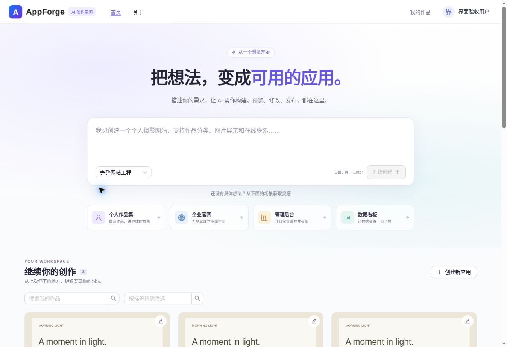
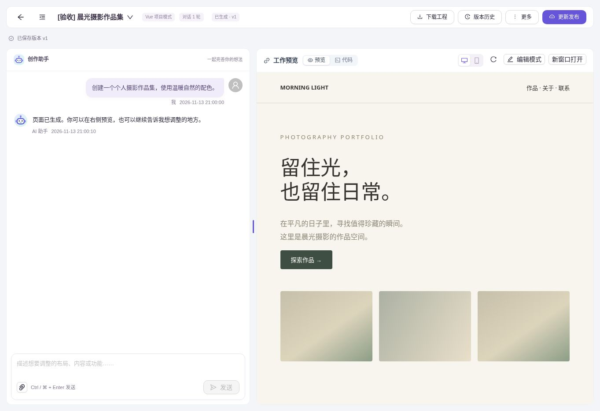
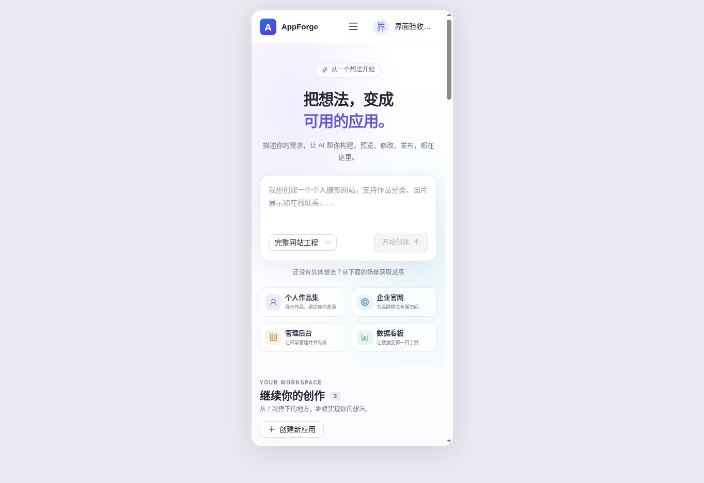
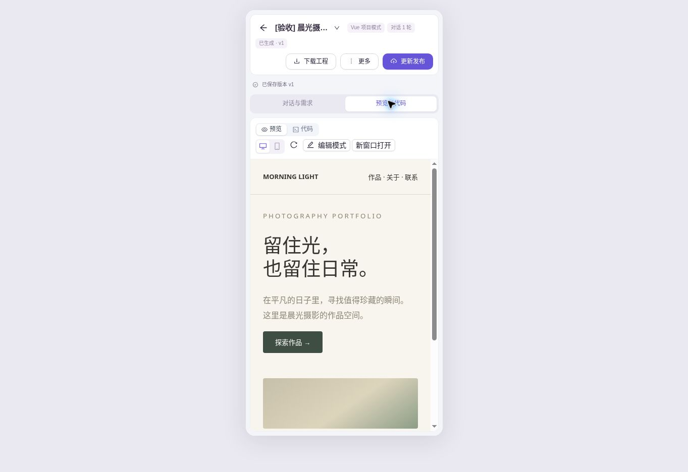

# 创作首页与工作区界面更新

这次更新基于 `796843c`，围绕需求输入、作品查找和生成预览改善界面。参考 NoCode 的创作入口与作品展示，以及 Z.ai 的场景引导，保留 AppForge 自己的应用生成流程。

## 变更范围

- 首页：轻量渐变背景、统一品牌色、四个可编辑场景示例、生成模式选择、我的作品与精选/公开案例。
- 作品卡片：真实封面、失败/生成中/待发布/已发布状态、更新时间、明确的继续编辑/查看对话与查看作品入口。
- 工作区：全屏对话与预览、拖动或键盘调整分栏、收起对话、桌面和手机尺寸预览、刷新预览、移动端双页签。
- 操作区：发布与下载置于顶部，保留版本历史、附件、可视化编辑、智能记忆、导出对话和详情菜单。
- 反馈：复用后端 SSE 进度显示当前操作；修改期间保留上个预览；失败后可把上次需求放回输入框，由用户修改后发送；列表请求失败显示重试入口。
- 统一主题、键盘焦点、按钮文字提示和减少动画偏好。

后端仅修复 `AppServiceImpl.createApp` 的模式选择：保留现有输入检查；用户显式指定模式时转交已有 `addApp` 持久化，未指定时保留自动路由。生成的 API 客户端、请求配置、环境变量和依赖锁文件未改动。没有新增后端接口或生产环境模拟数据。

## 模式一致性

前端明确选择 `multi_file` 时，后台不能再次自动分类为 `html`。创建服务先执行现有输入检查，再将经过检查的提示词与用户选定的模式交给已有 `addApp` 保存；没有指定模式的客户端保留自动分类与缓存。前端仍会核对服务实际返回的模式。

接口回归测试故意令路由器返回 HTML，再经过真实 POST、DTO、服务、ORM INSERT、数据库 SELECT 与查询响应，确认显式选择不会被覆盖，并确认未指定模式时自动路由仍然执行。另覆盖显式模式的输入检查、敏感内容处理、初始版本字段和无效模式拒绝。

## 接口与权限保持

| 功能 | 继续使用的入口 |
| --- | --- |
| 创建应用 | `createAppWithMode` → `/app/add` → `/app/get/vo` 确认生成模式 |
| 我的作品与案例 | `/app/my/list/page/vo`、`/app/good/list/page/vo`、`/app/public/list/page/vo` |
| 请求与流式生成 | `/app/chat/request` → `/app/chat/gen/code?requestId=…`，保留凭据和原有事件处理 |
| 对话历史 | `/chatHistory/app/{appId}`，保持分页和首次生成判断 |
| 预览 | `getAppPreviewUrl`，保持私有预览会话与可视化编辑参数 |
| 发布、下载、附件 | 原有处理函数和接口，包括 ZIP 下载回退入口 |
| 版本、记忆、详情 | 原有组件及接口 |
| 权限 | 继续区分创建者、管理员和其他用户；他人作品不可发送、上传、发布或下载 |

场景选择只填充提示词，不会创建应用。恢复上次需求只恢复文字，不会自动重发或重新上传历史附件。视图宽度、设备切换和预览刷新都不会触发模型调用。

## 验证

- `npm run build`：类型检查与生产构建通过。
- `npm test`：9 个测试文件、40 项测试通过。
- 修改文件的 ESLint 检查通过；`git diff --check` 通过。
- 对比编译后的关键函数，`sendMessage`、`openEventSource`、`initializeHistory`、`loadChatHistory`、发布、下载、停止、附件上传、导出与工作区操作的请求流程保持一致。

浏览器验收使用独立测试服务和带“[验收]”名称的固定数据；测试服务放在仓库外，没有接入真实模型、数据库或生产会话。桌面视口约 1363px，手机使用 390 × 844px 的 iframe 视口，验证媒体查询与实际内嵌页面布局。

已验证：

1. 场景选择填入需求，不自动提交；非默认的“轻量网站”通过真实前端代码传递 `multi_file`，创建后进入原有首次生成流程。
2. 读取已有项目和对话不会增加生成请求；真实前端请求日志中，新建测试应用只创建一次、首次请求只发送一次。
3. 桌面/手机预览、代码文件读取、拖动分栏、键盘左右键调宽与收起/展开对话正常。
4. 发布按钮调用原有接口，打开原有部署成功弹窗，并刷新应用信息。
5. 他人作品保持只读，不读取其私有对话历史，不展示拥有者专属操作。
6. 失败项目仍显示已有预览，“编辑上次需求”只填回文字。
7. 列表接口报错显示错误与重试入口；清除筛选并重新查询后恢复作品。
8. 手机首页和工作区未出现横向内容溢出，工作区可切换对话和预览。

仍需本地确认：使用当前 MySQL、Redis、真实模型、实际附件与构建环境，完成一次创建 → 生成 → 修改 → 下载 → 发布。隔离界面验收不替代这一步。

构建保留了当前项目既有的大包提示，未在界面改造中调整打包架构。

## 截图

以下都是实际前端构建的浏览器截图，作品内容为隔离验收示例。

### 桌面首页

### 桌面创作工作区

### 手机首页与工作区

