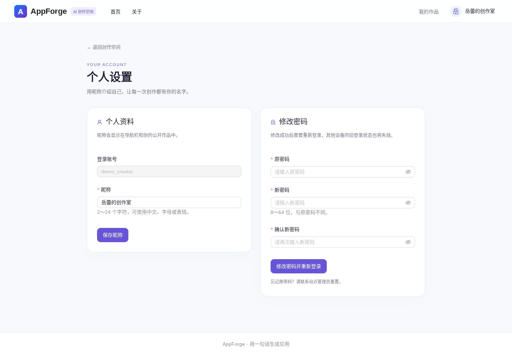
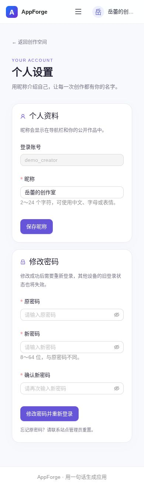

# 用户昵称与密码设置

## 使用方法

1. 登录后点击右上角头像或昵称，选择「个人设置」。也可以访问 `/user/settings`。
2. 昵称支持 2～24 个字符，前后空白会被移除；保存后立即更新导航，刷新或重新登录仍保留。
3. 修改密码需填写原密码、新密码和确认密码。新密码为 8～64 位，不能与原密码相同。
4. 修改成功后跳转登录页，使用新密码登录。其他设备的旧会话在下一次服务端身份校验时失效；已经开始的请求或流不会被主动中断。
5. 注册页增加昵称。旧客户端没有传昵称时，生成 `创作者_随机字符`，不再统一设置为「无名」。

已有用户的昵称不会批量改写，登录后可自行修改。管理员和普通用户均可使用；用户 id、角色、登录账号均不能通过个人设置修改。忘记原密码仍需管理员协助重置，此功能不是忘记密码找回。

## 接口

均沿用现有 `/api` 前缀、Cookie 会话及 BaseResponse。

| 接口 | 请求字段 | 成功结果 |
| --- | --- | --- |
| `POST /user/profile/update` | `userName` | 当前用户的 LoginUserVO，不包含密码 |
| `POST /user/password/update` | `oldPassword`、`newPassword`、`checkPassword` | `true`，并使当前会话失效 |
| `POST /user/register` | 原字段及可选 `userName` | 新用户 id |

后端从会话确定操作人，忽略伪造的 id、角色、账号等额外字段。密码使用带旧密码摘要条件的更新，避免并发改密覆盖。登录会话保留的原密码摘要与数据库比较，用于拒绝其他设备的旧会话。沿用项目现有密码摘要格式，兼容已有账号；本次不迁移密码存储算法，不增加表或修改配置。

## 验证

- `UserAccountSettingsTest`：14 项实际 MockMvc → 服务 → MyBatis-Flex → H2 测试，覆盖昵称落库、跨会话读取、身份伪造、匿名访问、非法输入、改密持久化、旧密码拒绝、旧会话失效、并发条件更新及注册昵称。
- 与 AppMetadata、AppServiceAccess、AppCreationMode、GuardrailAppService、LangchainConfiguration 合并回归：56 项通过。
- 前端 Vitest：10 个文件、56 项通过；TypeScript 检查及生产构建通过；变更文件 ESLint 通过。
- 实际生产构建的 Chromium 页面检查：1440×1000 与 390×844 均通过账号菜单入口、昵称保存/导航同步/刷新、改密校验和错误提示、成功后登录跳转、设置路由保护及注册提交昵称。页面无 JavaScript 异常和横向溢出。
- 浏览器检查使用隔离的 API 测试数据；数据库行为由 H2 HTTP 集成测试验证。本地真实 MySQL/Redis 与用户 Windows 环境尚需拉取后验收。
- 本次未重跑独立的封面 Chrome 截图检查；PR 原有截图超时问题不在本次修改范围。

本环境的 Mockito 自附加受限，回归测试显式使用 Mockito agent；CI 环境原有命令已增加 `UserAccountSettingsTest`。

## 页面截图

截图使用测试账号和虚构数据。

