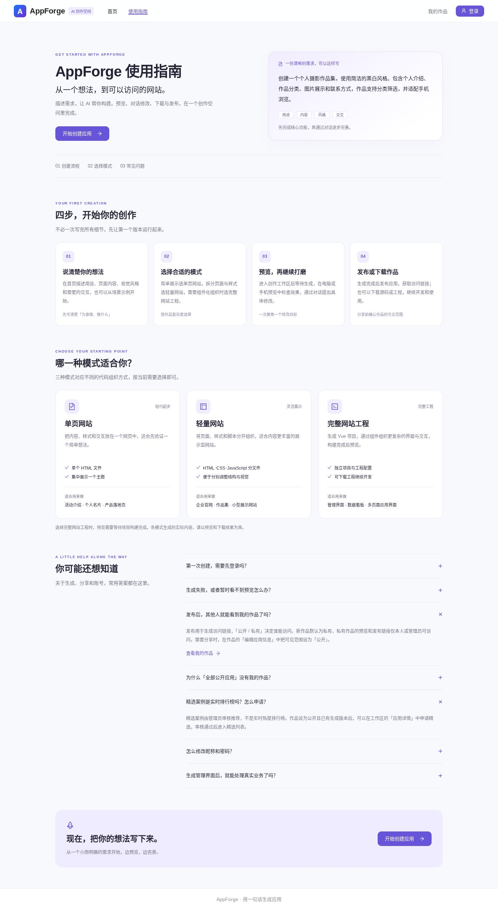

# 使用指南页面

将 `/about` 的路由与布局演示占位内容替换为面向用户的使用指南，导航文案改为「使用指南」，保留原地址以兼容已有链接。

## 页面内容

- 平台用途、可参考的需求描述，以及返回首页输入区的创建入口。
- 四步流程：描述需求、选择模式、预览修改、发布或下载。
- 三种生成模式对比。名称使用首页的 `generationModeLabel`，避免两处不一致。
- 七个常见问题：登录、生成失败与预览、发布和公开的区别、公开列表、精选审核、账号设置及示例数据。
- 目录通过路由锚点定位区块；常见问题使用原生 `details/summary`，支持键盘展开。

「开始创建应用」定位现有 `/#create-app`；「我的作品」定位 `/#my-apps`；「个人设置」进入现有 `/user/settings` 并沿用登录校验。指南本身无需登录，不发起创建或生成请求。本次没有修改后端、接口、生成逻辑或数据库。

## 验证

- 前端 Vitest：10 个文件、56 项通过；TypeScript 检查、生产构建、修改文件 ESLint 及 `git diff --check` 通过。
- Chromium 生产构建检查：1440×1000 桌面及 390×844 手机视口，通过导航进入、访客阅读、三种模式、目录定位、键盘展开常见问题、个人设置登录保护、我的作品和创建区跳转；无横向溢出或页面 JavaScript 异常，点击创建入口未自动发送创建/模型请求。
- 浏览器使用隔离的 API 测试响应验证页面和跳转；不代替真实 Windows 服务验收。本次为静态说明与导航更新，不新增镜像实现的单元测试，不重跑无关后端检查。

