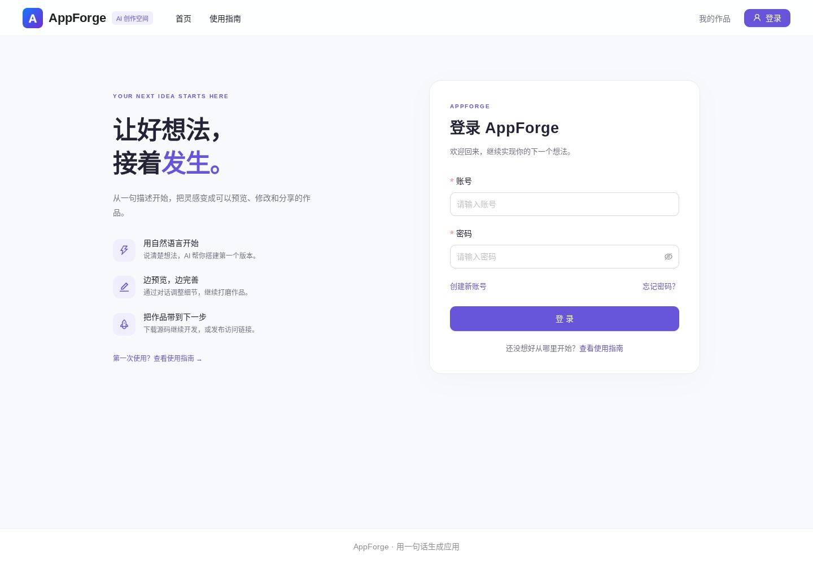
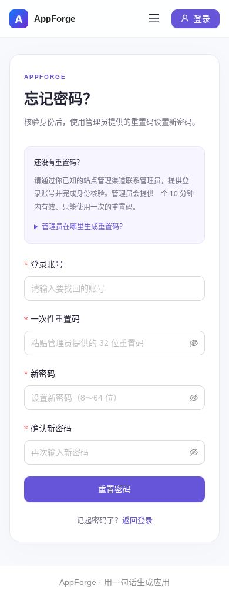
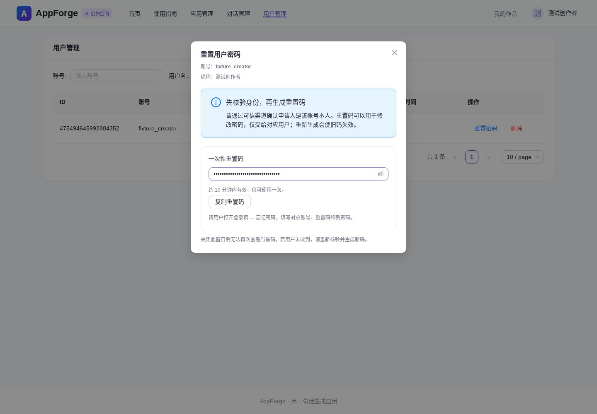

# 认证页面与忘记密码

## 页面

- 登录、注册、找回密码使用统一的 AppForge 卡片布局，桌面展示平台介绍，手机聚焦表单。
- 移除登录、注册标题及浏览器标签中的个人姓名；浏览器标签与图标统一为 AppForge。
- 登录页增加「忘记密码」，地址 `/user/forgot-password`。注册、找回与登录往返保留原站内目标，拒绝外站和反斜杠等异常跳转。
- 设置页和使用指南同步提供找回指引。密码、重置码不会写入 URL、本地持久化存储或日志；页面离开和重置成功后清除表单敏感值。

## 实际找回流程

项目尚未绑定用户邮箱或手机号，因此本次采用管理员协助核验的流程，不展示无法发送的邮件或短信验证码。

1. 用户通过已知的站点管理渠道联系管理员，提供登录账号，由管理员核实身份。
2. 管理员登录，在「用户管理」对应用户行点击「重置密码」，明确勾选已核验身份，生成一次性重置码。
3. 管理员通过可信渠道把码交给对应用户。界面不自动发送消息，重置码仅在签发响应中返回，关闭弹窗后不保留。
4. 用户在「忘记密码」页输入对应账号、重置码、新密码及确认值。成功后返回登录，使用新密码登录。

若没有任何管理员能够登录，需要由部署维护者通过已有维护渠道恢复；账号名称本身不能作为身份凭据。

## 接口与凭证

| 接口 | 访问条件 | 请求与结果 |
| --- | --- | --- |
| `POST /api/user/password/reset-code` | 当前管理员，且确认已核验身份 | `userId`、`identityVerified: true`；返回 `resetCode` 与 `expiresInSeconds: 600` |
| `POST /api/user/password/reset` | 可未登录，须持有有效码 | `userAccount`、`resetCode`、`newPassword`、`checkPassword`；成功返回 `true`，不自动登录 |

- 重置码由 SecureRandom 生成 24 字节（192 位），使用 32 位 URL 安全字符表示；有效期 10 分钟。同一用户重新签发后旧码被替换。
- Redis 仅存 SHA-256 摘要，并绑定签发时的用户密码摘要。错误账号/码不消费合法凭证；Lua 原子比较并删除，重复或并发兑换最多成功一次。
- 新密码需 8～64 位、与确认值一致且不同于当前密码；验证失败不消费合法码。数据库更新同时匹配用户 id 和原密码摘要，避免覆盖并发密码变更。
- 沿用现有账号密码存储格式和 `getLoginUser` 密码快照校验，兼容已有账号。当前会话在重置成功后失效，其他持有旧密码快照的会话在下一次鉴权时失效；已经开始的请求不会主动中断。
- 兑换前按连接地址每分钟最多 10 次；签发按管理员每分钟最多 10 次。客户端自填的 X-Forwarded-For 不参与该限流判断。反向代理后的共享地址可能共用额度，应根据实际部署配置可信代理。
- Redis 不可用时操作失败，不降级为账号直接改密。码已消费但数据库写入失败时不可重放，需要管理员重新核验并签发。
- 响应带 `Cache-Control: no-store`；敏感 DTO 不生成包含字段的 toString。审计仅记录操作人/目标用户 id，不记录码或密码。

复用现有 Redis，无新依赖、数据库表或生产配置。拉取后需要重启前后端，并保持原有 Redis 服务可用。

## 验证

- 后端 `PasswordRecoveryTest`：17 项真实 MockMvc → 服务 → MyBatis-Flex/H2 → Redis 7.4/Lua 测试，覆盖权限、核验确认、过期、重签、错误账号/码、重放、并发、数据库失败、改密后旧凭证、登录状态及限流。与账户、生成模式和访问控制相关回归合计 73 项通过。
- 前端 Vitest：11 个文件、76 项通过；类型检查、生产构建、变更文件 ESLint 与 git diff 检查通过。
- Chromium 1440×1000 与 390×844：验证登录/注册/找回跳转、昵称及密码确认、网络和业务错误重试、完成后清除输入、新密码登录、普通用户路由保护、管理员核验与签发、关闭弹窗清除码、无页面异常和横向溢出。
- 浏览器使用隔离 API 测试响应，数据库与一次性凭证行为由真实 H2/Redis 集成测试验证；未操作用户 Windows 数据或真实账号。
- CI 已增加隔离 Redis 服务，显式启用新测试；原独立封面 Chrome 超时检查未修改或跳过。

本环境 Mockito 测试显式使用 javaagent；在本地运行新增集成测试时，设置 `APPFORGE_PASSWORD_REDIS_TEST=true`、`APPFORGE_PASSWORD_REDIS_PORT` 并指向隔离测试 Redis，勿连接生产 Redis。

设计参考：[OWASP 忘记密码指引](https://cheatsheetseries.owasp.org/cheatsheets/Forgot_Password_Cheat_Sheet.html)、[Redis Lua 原子执行说明](https://redis.io/docs/latest/develop/programmability/eval-intro/)。

截图均为虚构测试账号，管理员截图中的重置码默认隐藏。

