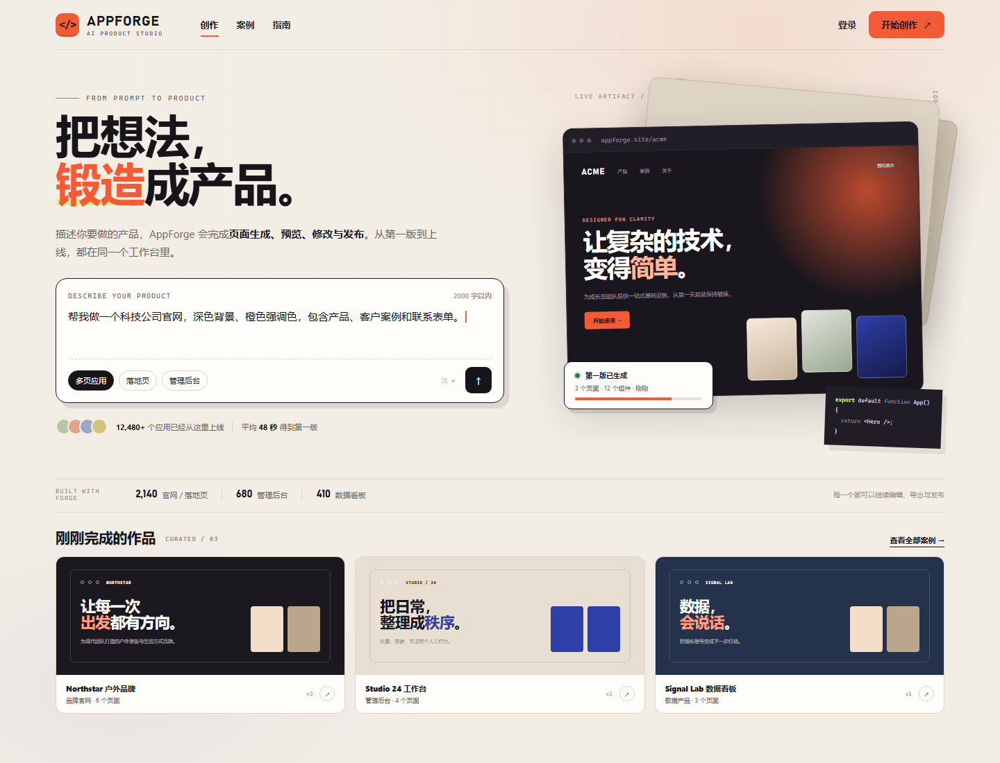
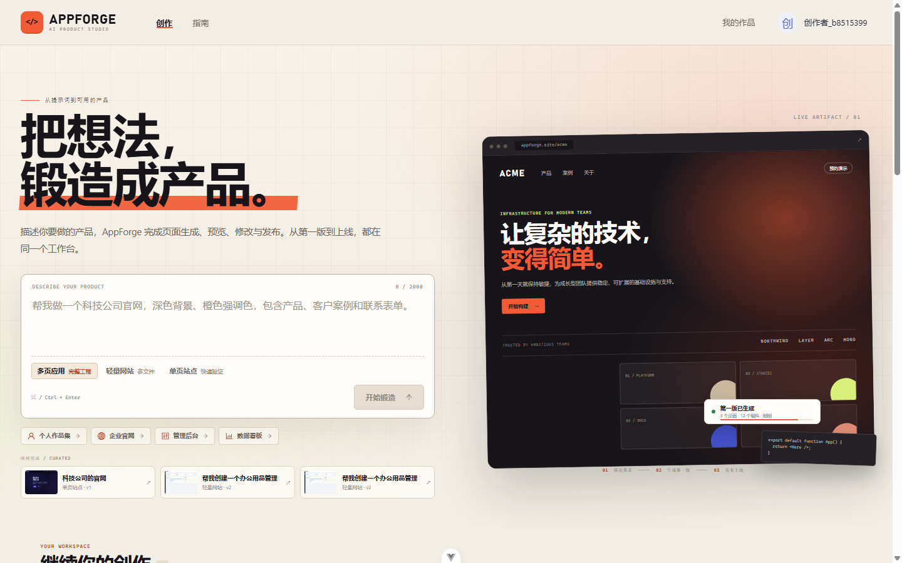
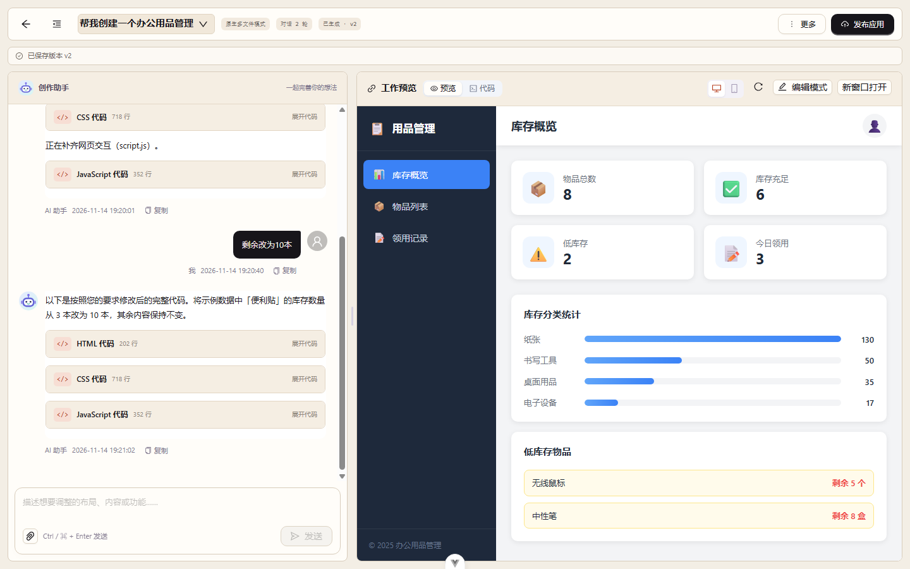
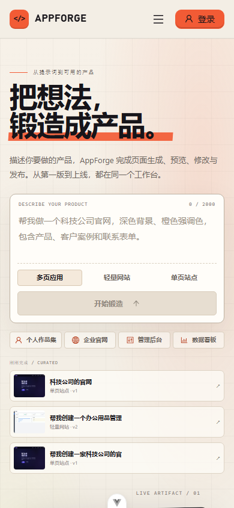
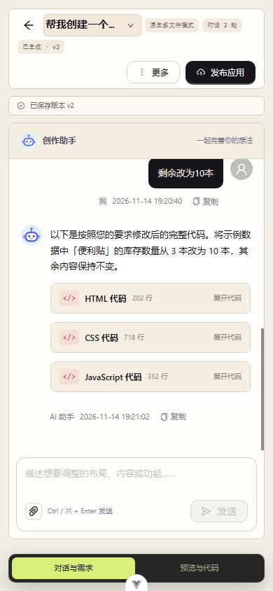
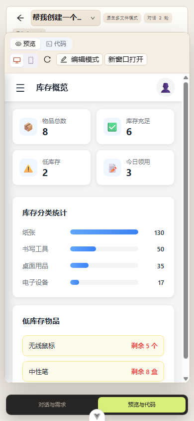
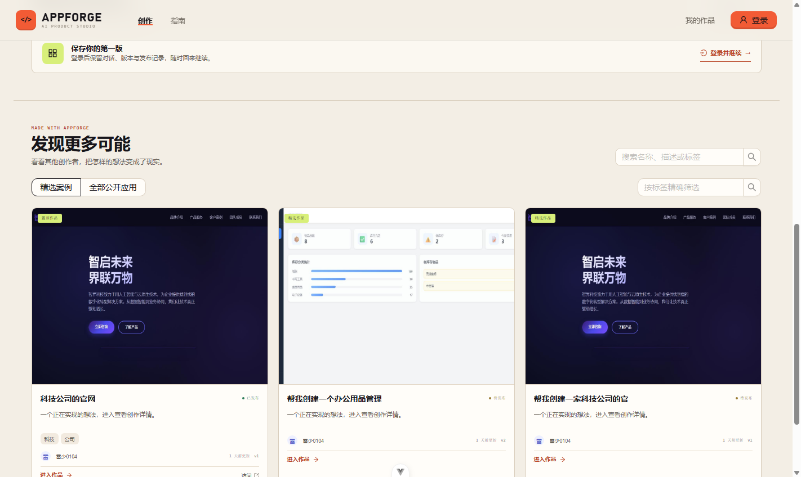
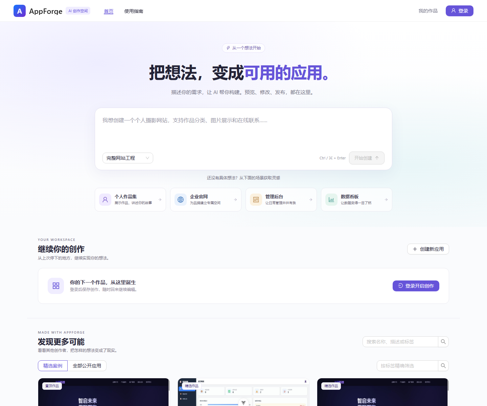
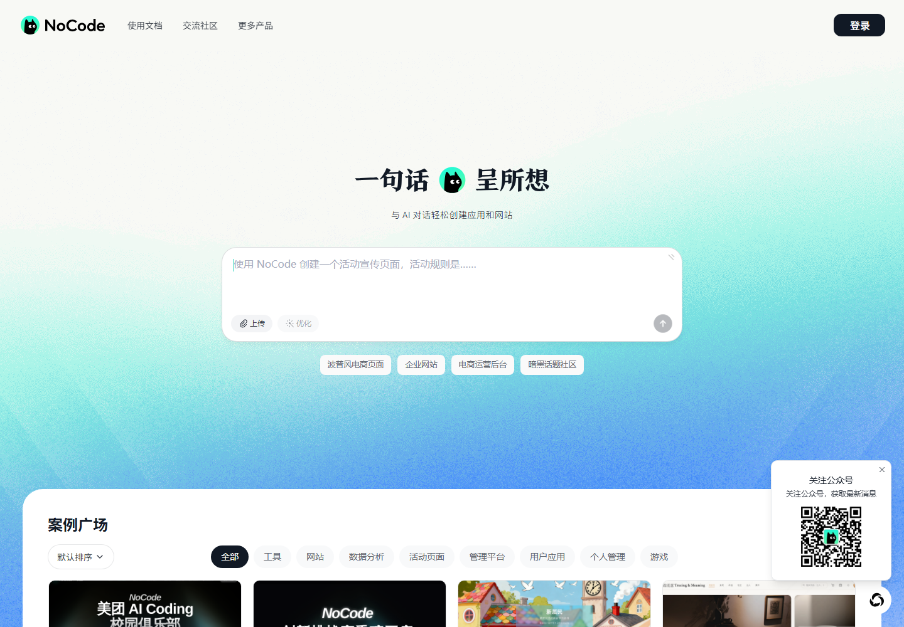
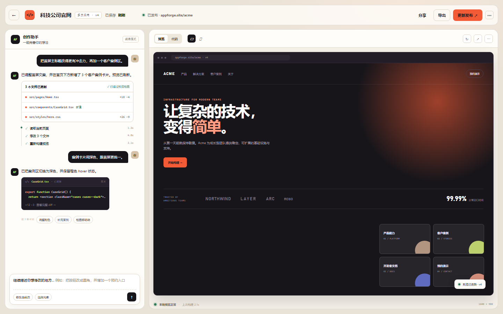

# AppForge 前端界面设计审计与改版方向

> 角色：资深 UI / 产品设计师视角
> 范围：当前公开首页、登录后工作台、对话生成页、预览/代码区、应用卡片
> 产出：审计结论、改版方向、设计 token、页面线框、视觉 mockup、素材与参考清单
> 状态：**P0–P2 主体已实施**（分享访问链接已接入；⌘K 选区 / ⌘S 保存快捷键仍待补），以下保留设计提案作为对照；实现截图见「已实施效果」。

## 已实施效果

| 首页（桌面） | 工作台（桌面） |
| --- | --- |
|  |  |

| 首页（移动 390） | 工作台对话（移动 390） | 工作台预览（移动 390） |
| --- | --- | --- |
|  |  |  |

已落地范围：Forge 设计 token、品牌 header、双栏首页与 artifact 证据、模式 chip、精选作品条、应用卡片、工作台顶部动作收敛、生成结果摘要/时间线、代码 diff/搜索/复制、移动端底部 dock 与预览 sheet、聊天代码卡。验证命令：`npm run type-check`、`npm run lint`、`npm run build-only` 均通过。

---

## 0. 当前界面

## 1. 一句话结论

**现在的界面“干净、完整、能用”，但还没有形成 AppForge 自己的产品气质。**
它像一个完成度不错的通用 AI 模板：紫色渐变、大圆角、大留白、白色 prompt 卡。问题不是“不好看”，而是**品牌记忆点弱、首屏行动路径长、生成结果出现得太晚**。

如果只做一轮改版，我建议不要继续在紫色 AI 模板上微调，而是转向一个更有“创造工具”质感的方向：

> **Forge / 锻造台**：暖纸色 + 近黑 + 熔融橙，像一间现代工作坊，而不是另一家紫色 AI 网站。

目标不是变“更炫”，而是让用户一眼感到：**这里真的能把想法做成产品**。

---

## 2. 当前界面审计

### 2.1 做得好的地方

- **价值主张清楚**：“把想法，变成可用的应用”一句话能听懂。
- **主路径明确**：首页 prompt → 创建 → 对话修改 → 预览 → 发布，产品闭环完整。
- **克制**：没有过度插画、没有复杂装饰，信息层级基本干净。
- **工作台架构正确**：左侧对话、右侧预览/代码，是可扩展的 AI 创作形态。
- **状态覆盖完整**：生成中、失败、停止、封面生成中、版本历史、发布状态都有反馈。
- **可访问性有基础**：有 focus ring、aria-label、键盘提交、reduced-motion 处理。

### 2.2 关键问题

#### ① 品牌感偏弱，像“通用 AI 模板”

当前主色 `#6654d9`、浅紫渐变、白色大圆角卡片，和大量 AI 产品高度同质化。
Logo 是一个圆角方块里的 “A”，没有形成可识别的品牌符号；导航、按钮、卡片都偏“组件库默认感”。

**结果**：用户会记得“一个 AI 生成网站的工具”，但不容易记住 **AppForge**。

#### ② 首屏“空”且“慢”

- Hero 占满首屏，但右侧没有产品证据，只有大面积渐变。
- 场景卡是四个等宽导航卡，视觉重量接近，用户要先读一遍才知道点哪个。
- “继续你的创作”在未登录时是一张很大的登录提示卡，占据首屏下方最宝贵的位置。
- 真正的案例/作品被推到很下面，用户看不到“别人做出来了什么”。

**结果**：第一屏只完成了“解释”，没有完成“证明”和“转化”。

#### ③ 创作入口有技术感，不像给创作者用的

- “完整网站工程”是工程术语，不是用户语言。
- 生成模式下拉藏在 prompt 面板底部，重要但不够显眼。
- 提交按钮在空输入时是禁用态，缺少“我可以先看看示例”的引导。
- 场景卡点击后只是填入 prompt，缺少“模板预览”，用户不知道会得到什么。

#### ④ 工作台信息密度偏高，主行动不突出

当前对话页顶部同时有：对话轮数、生成状态、版本号、下载源码、版本历史、更多、发布。
右侧预览区又有：预览/代码 Tab、设备切换、刷新、新窗口、编辑模式等。

**结果**：每一块都合理，但合在一起没有“我现在最该做什么”。
发布是最终目标，却和下载、历史、更多混在同一层级。

#### ⑤ 应用卡片缺少“作品感”

- 封面失败时是灰色线框 + “暂无页面预览”，像空状态而不是作品。
- 卡片信息顺序是：封面 → 作者/状态 → 描述 → 标签 → 时间/版本 → 操作。
- 缺少“这是什么类型的产品”“被谁使用/精选”“一键 remix”等能激发点击的信号。
- 状态标签（已发布/待生成）视觉重量弱，扫视时不够清晰。

#### ⑥ 聊天区的“生成过程”还不够像创作

- 进度是工具调用列表，用户能看到“读文件/写文件”，但不容易理解“现在做到哪一步、还差什么”。
- 代码块折叠是对的，但缺少“这次改了哪些文件 / 预览变化”的结果摘要。
- 错误提示能显示具体 message，这是优点；但错误态和空态的视觉语言还比较普通。

### 2.3 粗略评分

| 维度 | 分数 | 说明 |
|---|---:|---|
| 视觉完成度 | 7.5 | 干净、统一，但有模板感 |
| 品牌识别 | 5.5 | 紫色 + 圆角 + AI 渐变，缺少独占符号 |
| 首屏转化 | 6.0 | 价值主张清楚，但证据和案例出现太晚 |
| 信息架构 | 7.0 | 主路径完整，工作台层级偏多 |
| 创作工具感 | 6.5 | 对话 + 预览架构对，但过程表达偏工程 |
| 移动端 | 6.5 | 有双 pane 切换，但仍是桌面缩小版 |
| 可访问性 | 7.0 | 有基础，对比度和键盘路径还可加强 |

**综合：约 6.8 / 10。**
不是“重做”，而是“从通用 AI 模板升级为有品牌主张的创作工具”。

### 2.4 可访问性提醒

- 当前 `--forge-muted: #737386` 在 `#f8f9fc` 上约 **4.41:1**，低于正文 AA 的 **4.5:1**；建议改为 `#6B6B80` 或更深。
- 新提案里的橙色 `#F25B35` 在纸色上约 **2.87:1**，**不要用于小号正文**；只用于填充、图标、大字号强调。橙色按钮上的文字用近黑 `#17151A`。
- 工作台的状态点不能只靠颜色区分，需同时有文字（已发布/生成中/失败）。
- 代码块/预览区要保留键盘可达的 Tab、复制、展开/收起。

---

## 3. 参考拆解

### NoCode（https://nocode.cn/）

值得借鉴：

- **品牌对比强**：黑 + 青绿，一眼记住；标题里直接把 Logo 变成语义符号。
- **首屏有“场”**：薄荷到青蓝的大面积渐变，不是普通白底 + 紫色按钮。
- **prompt 更紧凑**：输入区不追求巨大，底部“上传/优化”是创作工具信号，圆形提交更轻。
- **示例是 chip，不是大卡**：4 个小标签，降低选择成本。
- **案例广场在首屏底部就露出**：用户立刻看到“做出来是什么样”。

不要照搬：

- 大面积高饱和渐变很吃品牌资产；AppForge 如果直接用，会像另一个 NoCode。
- 案例卡的信息密度偏高，初次使用可能压倒新用户。

### Z.ai（https://zchat.z.ai/）

可作为“AI 工作台”的参考，而不是消费级首页模板：

- 对话与产物并置，强调“正在生成的东西”，而不是聊天记录本身。
- 深色工作区 + 清晰模型/工具状态，适合表达“专业工具”。
- 控制项集中在输入区附近，减少顶部按钮。

> 说明：该站点在 headless 截图时未稳定渲染，因此这里只引用其公开产品形态，不作为像素级参考。

### 其他建议参考

| 类型 | 参考 | 看什么 |
|---|---|---|
| AI 建站 | Lovable、v0 | prompt → artifact 的节奏、生成结果的首屏呈现 |
| 编辑工具 | Framer、Webflow | 画布/预览/代码的关系，发布路径 |
| 专业工具 | Linear、Raycast | 紧凑、键盘优先、状态表达 |
| 案例社区 | Godly、Land-book、Mobbin | 作品卡、分类、筛选、hover 细节 |
| 动效/3D | Spline、Rive | 品牌吉祥物/生成过程的轻量动效 |

---

## 4. 改版方向：Forge / 锻造台

### 4.1 核心概念

AppForge 的名字本身就有很强的隐喻：**把想法锻造成产品**。
当前界面只用了“AI 生成”的通用语言，没有用上“forge”的独特资产。

建议把品牌从“紫色 AI 助手”转向：

> **一间现代数字工作坊：暖纸色桌面、黑色工作台、橙色火花。**

关键词：**Warm precision / 手作感 / 工程可信 / 结果前置**

### 4.2 视觉主张

- **底色**：暖纸色 `#F3EEE5`，不是纯白或冷灰；让界面有“桌面/工作坊”的质感。
- **主色**：熔融橙 `#F25B35`，只用于关键行动、生成中、品牌符号；不大面积铺渐变。
- **结构色**：近黑 `#17151A`，用于标题、主按钮、深色预览画布。
- **辅助色**：钴蓝 `#2F3FA8`（链接/数据/选中）、青柠 `#D8EF7A`（成功/高亮/代码）、米白 `#FFFDF9`（卡片）。
- **形状**：10–16px 圆角，少量硬边框和 1px 线；减少“全都 24px 大圆角”的软塌感。
- **排版**：标题用窄体/几何无衬线（Bahnschrift / DIN 风格），正文用系统中文无衬线；代码/标签用等宽字体。
- **动效**：短、克制，180–240ms；生成中用“火花/扫描线”而不是全屏 shimmer。

### 4.3 设计 token 建议

| Token | 值 | 用途 |
|---|---|---|
| `--ink` | `#17151A` | 主文字、深色画布、主按钮 |
| `--ink-2` | `#2B2730` | 次级深色 |
| `--paper` | `#F3EEE5` | 页面底色 |
| `--card` | `#FFFDF9` | 卡片/浮层 |
| `--line` | `#DDD3C4` | 分隔线、边框 |
| `--muted` | `#6B645B` | 次级文字（对比度 5.05:1） |
| `--orange` | `#F25B35` | 主 CTA、品牌强调 |
| `--orange-soft` | `#FBE4DA` | 选中/浅底 |
| `--lime` | `#D8EF7A` | 成功、代码高亮、生成中 |
| `--cobalt` | `#2F3FA8` | 链接、数据、选中 |
| `--green` | `#2F7D5A` | 在线/成功 |
| `--radius-sm` | `8px` | 按钮、输入 |
| `--radius-md` | `12px` | 卡片、面板 |
| `--radius-lg` | `16px` | 大面板/浏览器框 |
| `--shadow-1` | `0 1px 2px rgba(23,21,26,.06)` | 卡片默认 |
| `--shadow-2` | `0 8px 24px rgba(23,21,26,.08)` | hover/浮层 |
| `--shadow-3` | `0 24px 60px rgba(23,21,26,.16)` | 主视觉 artifact |

字体建议：

- 中文正文：`"PingFang SC", "Microsoft YaHei", "Noto Sans SC", sans-serif`
- 西文/数字：`"Bahnschrift", "DIN Alternate", "Inter", sans-serif`
- 代码/标签：`"Cascadia Mono", "JetBrains Mono", "Consolas", monospace`

---

## 5. 页面改版方案

### 5.1 首页：从“解释产品”变成“展示结果”

**结构建议**

1. **Header 64–72px**
   - 左：Logo + 字标 + `AI PRODUCT STUDIO` 小字。
   - 中：`创作 / 案例 / 指南`，最多 3 项。
   - 右：`登录` 文本 + `开始创作` 橙色主按钮；不要再放第二个同义按钮。

2. **Hero 双栏（桌面）**
   - 左 52%：eyebrow + 大标题 + 一句具体价值 + 紧凑 prompt。
   - 右 48%：**产品证据**——正在生成的浏览器 artifact、文件变更浮层、代码片段。让用户第一眼看到“结果长什么样”。
   - 标题建议保留“把想法，变成可用的应用”的语义，但用“锻造/产品”强化品牌；例如：
     - `把想法，锻造成产品。`
     - `说出想法，剩下的交给 AppForge。`
   - 副标题要具体：`生成页面、预览、修改、发布，在同一个工作台完成。`

3. **Prompt 面板**
   - 高度控制在 180–210px，不要占据半屏。
   - 顶部一行小标签 `DESCRIBE YOUR PRODUCT`，右侧字数。
   - 底部用 **模式 chip**：`落地页 / 多页应用 / 管理后台`，替代“完整网站工程”这种工程术语。
   - 主按钮 `开始创建 ↑`，右侧显示 `⌘ ↵`。
   - 增加“从模板开始”或“看看示例”的次级入口。

4. **首屏证据**
   - prompt 下方直接放 **3 个刚刚生成的作品卡**，带真实封面、类型、版本、作者。
   - 案例在首屏底部露出，用户不用滚动很久就能看到“别人做出来了什么”。
   - 未登录时不要放巨大的“登录开启创作”卡；用一条轻量 inline CTA 或把登录动作放在作品卡之后。

5. **场景区**
   - 从 4 个等宽 icon 卡，改成 **横向模板卡**：每个卡带一个小的页面缩略图 + 一句结果描述。
   - 例如“企业官网 / 5 分钟上线一个可信的品牌门面”，比“企业官网 / 为品牌建立专属空间”更有结果感。

6. **发现更多**
   - 卡片改为作品流：封面为主，信息层只保留 `名称 / 类型 / 作者 / 状态`，hover 再显示 `查看 / Remix`。
   - 筛选用 pill，不要两个 input search 并排。

**首页要避免**

- 大面积紫色渐变 + 白色大圆角的“AI 模板感”。
- 首屏只有解释、没有作品证据。
- 4 个同等重量的场景卡。
- 登录前用大卡占据“继续你的创作”的位置。

### 5.2 工作台：从“功能堆叠”变成“创作节奏”

**顶部栏**

当前：应用名 + 类型 + 保存状态 + 发布状态 + 分享/导出/发布/更多。
建议：**两级信息**。

- 左：返回 + 应用名（可点击重命名）+ 类型 badge + `v4`。
- 中：一条状态线：`已保存 → 生成中 → 预览通过 → 已发布`，只显示当前状态和最近一步。
- 右：`分享`（次要）、`更新发布`（唯一主按钮）、`⋯`（导出、下载、历史、详情、智能记忆都收进去）。

**对话区**

- 标题只保留“创作助手 + 当前模式”，不要重复“一起完善你的想法”。
- 用户消息用深色气泡；AI 消息不要大气泡，直接放在纸面上，减少“聊天软件”感，强化“工作台记录”感。
- 每次生成后插入 **结果摘要卡**：
  - `3 个文件已更新`
  - 文件列表 + `+18 −4`
  - `预览已刷新` / `构建 2.1s`
  - `查看 diff` / `撤销这次修改`
- 过程用一条轻量时间线，不要把所有工具调用都铺开；默认折叠，失败时展开。
- 错误态：保留后端具体 message，但要有一句“下一步可以怎么做”，并提供 `重试 / 编辑需求 / 查看日志`。

**预览/代码区**

- Tab 只保留 `预览 / 代码`；设备切换、刷新、新窗口放在右侧 icon group。
- 预览外层用浏览器 chrome + URL，强化“这是一个真实产品”的感觉。
- 代码视图：文件树 + 当前文件 tab + `Diff` 开关 + 搜索 + 复制/下载；生成后默认展示 diff，而不是完整文件。
- 发布成功后，预览区出现一条轻量 toast：`已发布到 appforge.site/acme ↗`。

**移动端**

- 不要简单把双栏压成上下；用底部 sheet：
  - 默认对话全屏，顶部一个可拖拽的“预览”peek。
  - 生成完成时 sheet 自动升到 60%，展示结果。
  - 输入框固定底部，附件/模式放在输入框上方一行。
- 触控目标 ≥ 44px；代码视图在小屏默认只读，不强行编辑。

### 5.3 应用卡片：让作品自己说话

- 封面比例 16:10 或 4:3，优先展示页面首屏，不要灰色占位。
- 无封面时用 **类型化占位**：官网用深色品牌版式、后台用浅色表格版式、数据看板用图表版式；不要统一灰框。
- 信息层级：
  1. 封面 + 状态点（已发布/生成中/失败）
  2. 名称（2 行以内）
  3. 类型 + 版本 + 更新时间
  4. 作者/精选标识
- hover：封面轻微 scale + 底部浮出 `查看 / 继续编辑 / Remix`。
- 状态颜色要统一：已发布=绿、生成中=橙、失败=红、待生成=灰；不要只用浅色文字。

---

## 6. 组件与交互规范

### 按钮

- 主按钮：深色底 + 白字，或橙色底 + 深色字；一个屏幕只保留一个主按钮。
- 次按钮：透明底 + 1px 线；不要和主按钮同样重量。
- 文本按钮：用于“查看全部/展开/收起”，不要用于关键提交。

### 输入

- 边框 1px `--line`，focus 时 1.5px `--ink` + 3px `--orange-soft` ring。
- prompt 输入框不要用巨大的 placeholder 文案；用 1 行示例 + 1 行 hint。

### 状态

- 生成中：橙色点 + 文案 + 进度线；不要全屏 skeleton 遮挡预览。
- 成功：绿色点 + 结果摘要；失败：红色点 + 具体原因 + 下一步。
- 空状态：用“下一步动作”而不是“暂无数据”。

### 动效

- 页面进入：160ms opacity + 8px translate。
- 卡片 hover：180ms translateY(-2px) + shadow。
- 生成中：只在状态点和进度线做循环，不做全屏呼吸。
- 尊重 `prefers-reduced-motion`。

---

## 7. 素材与参考清单

### 7.1 直接可用的参考站

- NoCode：https://nocode.cn/ （品牌对比、首屏场域、紧凑 prompt）
- Z.ai：https://zchat.z.ai/ （AI 工作台、对话 + 产物）
- Lovable：https://lovable.dev/ （生成结果前置、社区作品）
- v0：https://v0.dev/ （代码/预览切换、极简黑白）
- Framer：https://www.framer.com/ （画布/发布路径、强排版）
- Linear：https://linear.app/ （紧凑工具感、状态表达）
- Raycast：https://www.raycast.com/ （键盘优先、命令面板）
- Spline：https://spline.design/ （3D artifact、品牌动效）
- Godly：https://godly.website/ （案例排版）
- Land-book：https://land-book.com/ （落地页灵感）
- Mobbin：https://mobbin.com/ （移动端/工作台流程）
- Refero：https://refero.design/ （真实产品截图）

### 7.2 字体

- Bahnschrift / DIN Alternate：Windows 自带，适合标题/数字。
- Inter：https://rsms.me/inter/
- Manrope：https://fonts.google.com/specimen/Manrope
- Noto Sans SC：https://fonts.google.com/noto/specimen/Noto+Sans+SC
- JetBrains Mono：https://www.jetbrains.com/lp/mono/
- 得意黑（中文展示）：https://github.com/atelier-anchor/smiley-sans

### 7.3 图标

- Lucide：https://lucide.dev/
- Phosphor：https://phosphoricons.com/
- Heroicons：https://heroicons.com/
- 建议统一 1.5px stroke；不要混用 Ant Design 实心/线性图标。

### 7.4 UI 套件 / 灵感

- shadcn/ui：https://ui.shadcn.com/
- Untitled UI：https://www.untitledui.com/
- Origin UI：https://originui.com/
- Aceternity UI：https://ui.aceternity.com/ （只取动效，不照搬视觉）
- Cult UI：https://www.cult-ui.com/
- Figma Community：搜索 `AI workspace`, `landing page`, `developer tool`

### 7.5 纹理/背景

- 纸纹/噪点：https://www.transparenttextures.com/
- 网格：CSS `linear-gradient` 64px grid（本提案已用）
- 渐变：https://meshgradient.com/ （只做低饱和局部光，不做整屏）
- 3D 浏览器/设备框：https://spline.design/ 或 Figma 社区 mockup

### 7.6 图片素材

- Unsplash：https://unsplash.com/ （团队/工作场景，仅用于案例封面占位）
- Pexels：https://www.pexels.com/
- 不建议用泛化的“AI 机器人”插画；用真实产品界面/工作场景。

---

## 8. 优先级路线

### P0：不动架构，先提升“第一眼”

1. 首页 Hero 改成双栏：左侧文案 + prompt，右侧 artifact 证据。
2. 首屏下方露出 3 个作品卡；未登录不再放大登录卡。
3. 把“完整网站工程”改成用户语言，模式 chip 上移。
4. 工作台顶部动作收敛为 `发布` + `更多`；下载/历史/详情进 overflow。
5. 应用卡片状态色和封面占位统一。

### P1：建立品牌系统

1. 替换全局 token：暖纸底、近黑、熔融橙、青柠成功色。
2. 重做 Logo/字标/图标风格；建立 1 个品牌符号（火花/锻锤/F 形）。
3. 统一圆角/阴影/边框；减少大面积渐变。
4. 首页案例区改成作品流，补 hover/筛选/空状态。
5. 生成过程改成“结果摘要 + 可展开时间线”。

### P2：工作台体验

1. ✅ 预览/代码双栏重排，代码默认 diff。
2. ✅ 移动端底部 sheet + 预览 peek。
3. ✅ 已发布应用可在“更多”中复制访问链接；二维码分享待补。
4. ◐ `⌘/Ctrl + Enter` 发送已保留；`⌘K` 选区、`⌘S` 保存仍待补。
5. ✅ 可访问性：对比度、focus、减少动画、屏幕阅读器状态。

---

## 9. 设计交付物

本目录包含：

- `ui-redesign-home.png`：首页改版概念图（1440×1100）
- `ui-redesign-workspace.png`：工作台改版概念图（1440×900）
- `home.html` / `workspace.html`：可编辑的视觉稿源文件
- `design-system.css`：本提案的 token/基础组件样式
- `ref-nocode.png`：NoCode 参考截图

> 这些是设计素材，不是生产代码；没有修改 `appforge-vue` 的任何业务文件。

---

## 10. 最后建议

不要同时改首页、工作台、卡片和品牌。
**先做首页 Hero + 作品证据 + 工作台顶部动作收敛**，这三件事最能改变用户对产品的第一印象；品牌色和组件系统可以紧随其后。

如果只能选一个方向：**把“紫色 AI 模板”换成“暖色锻造台”，把“解释”换成“展示结果”。**
